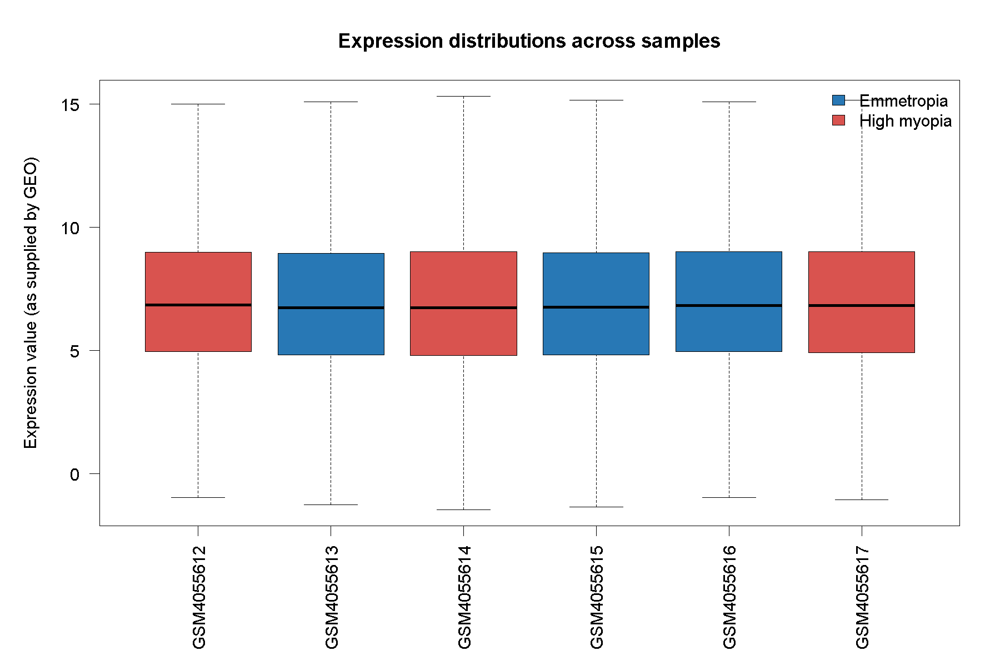
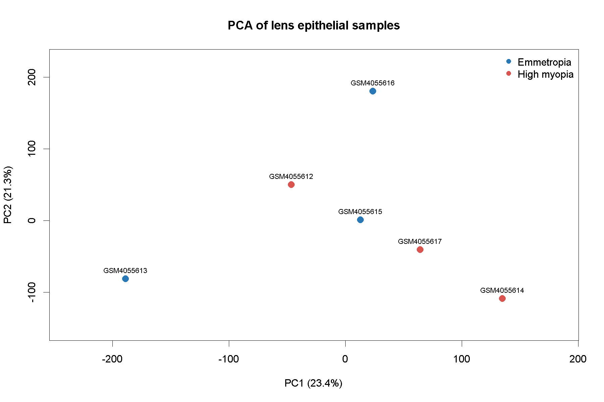
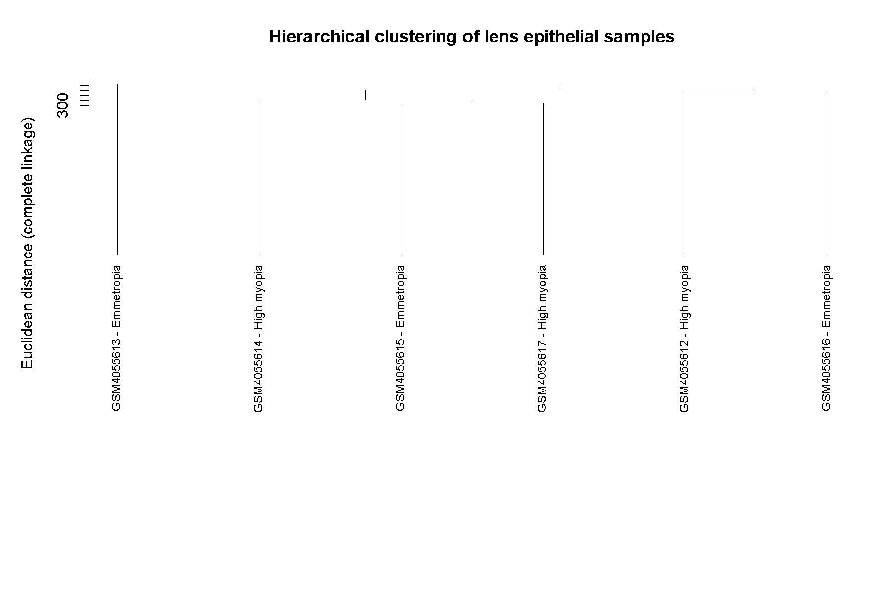
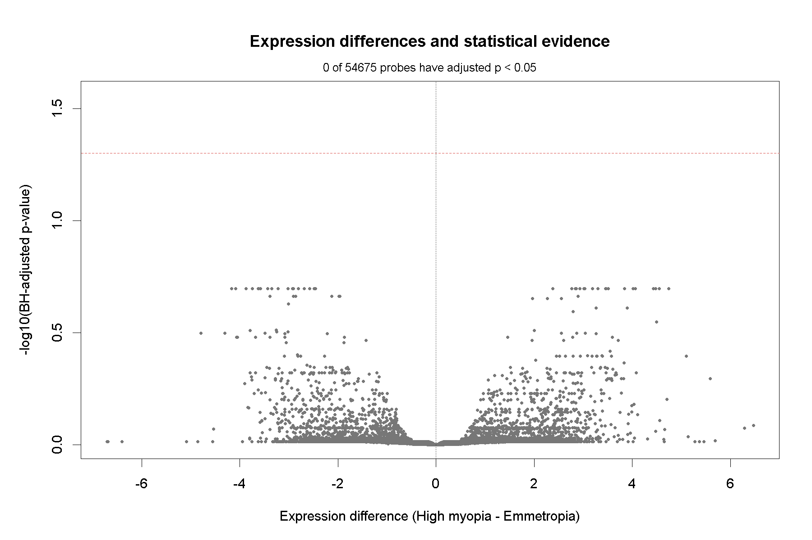
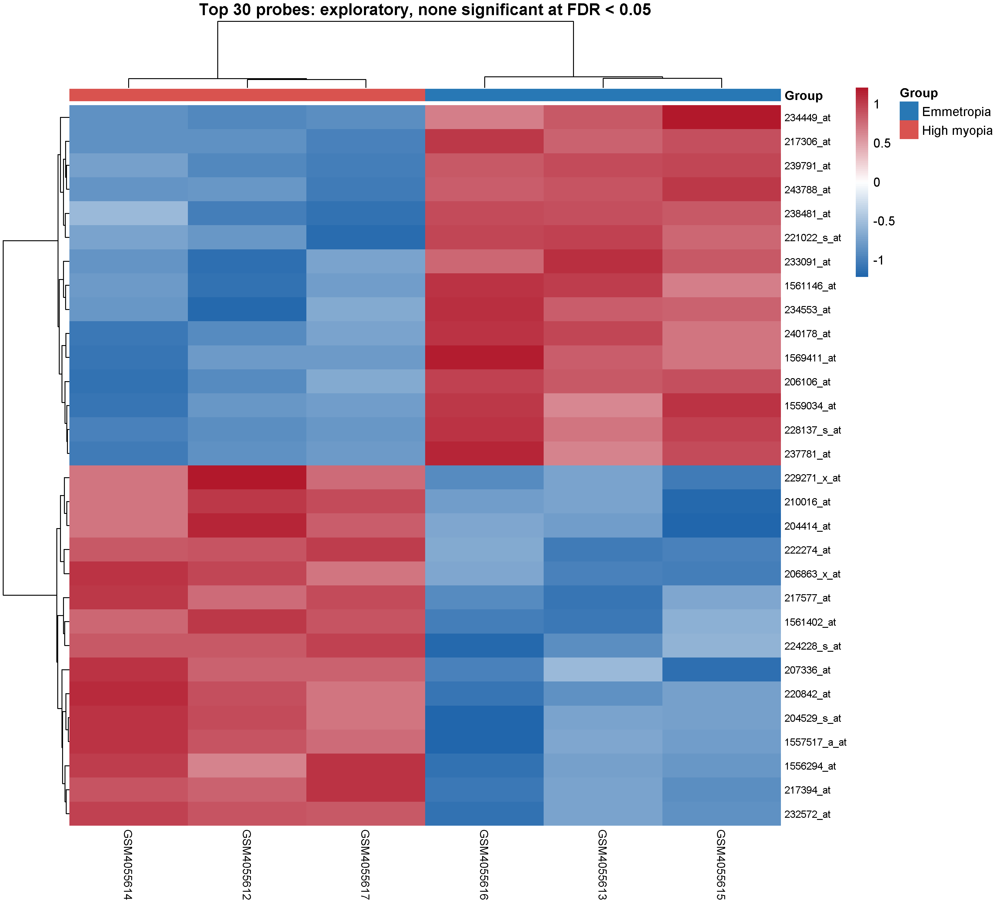

# Comparative Expression Analysis of High-Myopia and Emmetropic Human Lens Epithelium

## Project overview

I analysed the public NCBI GEO dataset **GSE136701** to explore expression differences between human lens epithelial samples from highly myopic and emmetropic eyes. My research question was: **Which measured probes show evidence of different expression between these two groups?** I used R to download the data, check sample information, explore expression patterns, fit statistical models, and produce figures and result tables.

The dataset contains three samples per group and 54,675 measured probes. In this analysis, **no probes met the Benjamini–Hochberg-adjusted p-value threshold of 0.05**. This is the main statistical finding. It does not demonstrate that the groups are biologically identical. The small sample size, variation between samples, and incomplete documentation of the expression scale limit interpretation.

This project is an exploratory reanalysis of existing data. It does not identify validated biomarkers, establish causes of myopia, or evaluate corrective lenses. The tissue studied is biological lens epithelium collected during surgery, rather than contact lenses or spectacle lenses.

## Objectives

1. Download a public human eye expression dataset reproducibly from NCBI GEO.
2. Verify sample identities, diagnostic groups, ages, and expression-data quality.
3. Explore sample distributions and relationships using boxplots, PCA, and hierarchical clustering.
4. Compare high-myopia and emmetropia samples using limma with multiple-testing correction.
5. Present the results transparently, including non-significant findings and methodological limitations.

## Dataset and participants

The source is [NCBI GEO accession GSE136701](https://www.ncbi.nlm.nih.gov/geo/query/acc.cgi?acc=GSE136701), titled “Comparing lens epithelium gene expression profiles between highly myopic and emmetropic eyes.” The platform is **GPL570**, the Affymetrix Human Genome U133 Plus 2.0 Array. The study metadata identify the tissue as **anterior lens epithelial cell membrane** and describe collection during lens surgery.

| Sample ID | Group | Age (years) | Gender recorded in GEO | Axial length (mm) |
|---|---|---:|---|---:|
| GSM4055612 | High myopia | 53 | Female | 29.98 |
| GSM4055613 | Emmetropia | 63 | Male | 22.30 |
| GSM4055614 | High myopia | 68 | Male | 31.54 |
| GSM4055615 | Emmetropia | 68 | Female | 23.44 |
| GSM4055616 | Emmetropia | 60 | Female | 22.99 |
| GSM4055617 | High myopia | 55 | Male | 34.74 |

The participants are adults aged 53–68 years. I use the recorded term “emmetropia” rather than assuming these surgical controls were healthy in every respect. The analysis concerns high myopia specifically and should not be generalised automatically to childhood myopia, all refractive errors, or other eye tissues.

Each expression-matrix row is a microarray probe identifier, and each column is a sample. The 54,675 rows are **not necessarily 54,675 distinct genes**. I retained probe identifiers throughout; gene-symbol annotation, pathway enrichment, and biological validation were not performed.

## Data acquisition and quality checks

The import script downloads the compressed GEO Series Matrix to a temporary file using `download.file()`. It then reads that file with GEOquery using `getGPL = FALSE`, extracts the expression matrix with `exprs()`, and obtains sample metadata with `pData()`. An internet connection is required each time the import script runs. The compressed download was approximately 1.5 MB.

I confirmed that the expression columns matched the metadata rows in exactly the same order. Diagnostic labels were extracted from the metadata rather than assigned by assumed sample position. The resulting group counts were three emmetropia and three high-myopia samples. Ages were extracted and exported with sample IDs and groups to `results/Sample_Information.csv`.

Initial checks found zero missing values and zero infinite expression values. The observed expression range was approximately −2.640 to 16.539, with a median of 6.788. All six samples and all 54,675 probes were retained. No missing-value imputation, low-expression filtering, or probe-to-gene aggregation was applied. Boxplot outlier symbols were hidden for readability; this did not remove any values from the analysis.

## Preprocessing and expression-scale verification

The GEO metadata state that the original researchers normalised the raw data using MAS 5.0 in GeneSpring 12.6.1. The sample VALUE column is described as MAS5.0 signal intensity. However, the inspected metadata do not explicitly document the transformation scale of the supplied values.

To check import fidelity, I downloaded the individual record for GSM4055612 and matched its probe identifiers to the matrix. All 54,675 finite values matched exactly: the maximum absolute difference was zero. This sample had 63 non-positive supplied values. Comparing the logarithm of the positive submitted values with the matrix did not produce a match; the maximum difference was approximately 12.128.

This comparison establishes that the matrix preserves the submitted sample values. It **does not establish whether the original researchers had already transformed those values**. I therefore applied no additional logarithmic transformation or normalisation. Estimated effects are labelled `Expression_Difference`, rather than confirmed log2 fold changes. This naming choice avoids an unsupported fold-change interpretation, but it does not resolve the underlying modelling uncertainty. The suitability of the supplied scale for linear modelling remains a limitation.

## Exploratory analysis

### Expression distributions



The six samples had broadly similar medians and interquartile ranges. No sample showed an obvious overall distribution shift in this plot. Similar distributions support further exploration, but do not prove the absence of technical artefacts or confirm the expression transformation.

### Principal component analysis



I performed PCA on the transposed expression matrix, treating samples as observations and probes as variables. Each probe was centred without scaling to unit variance. PC1 explained **23.40%** of variation and PC2 explained **21.26%**, together approximately **44.66%**. The first two components did not show clear separation between diagnostic groups. Both groups displayed variation between their individual samples.

### Hierarchical clustering



I calculated Euclidean distances between samples across all supplied probes and used complete-linkage hierarchical clustering. The resulting branches mixed diagnostic groups. GSM4055615 and GSM4055617 formed the closest pair, despite belonging to different groups. GSM4055613 joined the remaining samples last. I retained it because its clustering position alone did not justify excluding it.

## Differential expression method

I used limma to fit a separate linear model for each probe. The design matrix estimated a mean for each diagnostic group, and the contrast was **High myopia minus Emmetropia**. Positive expression differences indicate higher supplied expression values in the high-myopia group; negative differences indicate lower values.

I applied empirical Bayes moderation using `eBayes()` and obtained results using `topTable()`. Benjamini–Hochberg adjustment addressed multiple testing across 54,675 probes. The prespecified selection rule was **adjusted p-value < 0.05**. I did not add a fold-change cutoff or relax the significance threshold after inspecting the results.

The model contains diagnosis only. It does not adjust for age, gender, or other potential confounders. The results represent group-associated differences under this exploratory model, not an isolated causal effect of myopia.

## Differential expression results

| Measure | Result |
|---|---:|
| Probes tested | 54,675 |
| Probes with BH-adjusted p-value < 0.05 | 0 |
| Smallest reported adjusted p-value | 0.2008821 |

The top-ranked probe by unadjusted p-value was `217306_at`, with an estimated expression difference of −4.168130, an unadjusted p-value of approximately 0.000003706, and an adjusted p-value of 0.2008821. It did not pass the selected significance threshold. A small unadjusted p-value is insufficient when thousands of probes are tested simultaneously.

`results/All_Results.csv` contains the complete table. `results/Significant_Probes.csv` contains column headers and no data rows, which is the expected output for this result. The table includes probe ID, expression difference, average expression, moderated t-statistic, unadjusted p-value, adjusted p-value, and limma's B-statistic. The B-statistic is a model-based log-odds measure; selection in this project uses adjusted p-values.

### Effect and significance plot



The horizontal axis shows expression differences, while the vertical axis shows negative log10 BH-adjusted p-values. All points lie below the threshold line corresponding to 0.05. Horizontal bands arise because several probes share adjusted p-values. Some probes have sizeable estimated differences, but none meets the chosen statistical threshold.

### Exploratory top-30 heatmap



I selected the 30 probes with the smallest unadjusted p-values, breaking ties by probe ID. Each row was standardised across samples to a z-score for visual comparison. Red indicates expression above that probe's own average, and blue indicates expression below it. These colours do not compare absolute expression between different probes.

The selected probes separated the samples by diagnosis. However, they were selected using that same group comparison, making separation more likely. This is descriptive visualisation, not independent validation or evidence that the probes are statistically significant. It does not contradict the all-probe PCA or the multiple-testing result.

## Limitations and conclusion

The principal limitations are the small sample size, older surgical participant population, tissue-specific sampling, and uncertain transformation documentation. Age and gender are not perfectly balanced between groups and are not included in the model. The supplied data were not reprocessed from raw array files, and raw-array quality diagnostics were not performed. The linear-model assumptions have not been comprehensively validated, so statistical conclusions remain conditional on those assumptions.

The analysis is at probe level, without gene annotation or independent replication. The selected-probe heatmap must not be treated as a diagnostic classifier. Additional samples, clearer preprocessing documentation, raw-data quality assessment, and independent validation would be needed for stronger biological conclusions.

Overall, I completed a reproducible exploratory workflow and found **no probes significant at BH-adjusted p < 0.05 under the specified model**. This is a non-significant finding, rather than proof of equivalence between the groups. The project demonstrates data retrieval, quality checking, exploratory visualisation, statistical comparison, and transparent reporting of uncertainty.

## Repository contents

| Location | Purpose |
|---|---|
| `code/myopic and emmetropic human eye.R` | Download and inspect the GEO matrix |
| `code/02_quality_checks.R` | Verify groups and export sample information |
| `code/check_expression_scale.R` | Compare matrix values with an individual sample record |
| `code/03_exploratory_analysis.R` | Generate boxplot, PCA, and clustering figures |
| `code/04_differential_expression.R` | Run limma and export result tables |
| `code/05_results_visualisation.R` | Generate effect-significance plot and top-30 heatmap |
| `figures/` | Five analysis figures |
| `results/` | Sample table, analysis tables, and session information |

The download script provides access to the input data without requiring the compressed matrix to be committed. Temporary downloads are not a permanent local dataset archive.

## How to reproduce the analysis

Open the repository's RStudio project, or set the working directory to the repository root. Install the required packages once in a compatible R/Bioconductor environment:

```r
if (!requireNamespace("BiocManager", quietly = TRUE)) {
  install.packages("BiocManager")
}
BiocManager::install(c("GEOquery", "Biobase", "limma"),
                     update = FALSE, ask = FALSE)
if (!requireNamespace("pheatmap", quietly = TRUE)) {
  install.packages("pheatmap")
}
```

Run the scripts in this order within the same R session. Later scripts use objects created by earlier scripts:

```r
source("code/myopic and emmetropic human eye.R")
source("code/02_quality_checks.R")
source("code/check_expression_scale.R")
source("code/03_exploratory_analysis.R")
source("code/04_differential_expression.R")
source("code/05_results_visualisation.R")
writeLines(capture.output(sessionInfo()), "results/sessionInfo.txt")
```

The recorded environment was R 4.6.2 on Windows 11 x64, with GEOquery 2.80.1, Biobase 2.72.0, limma 3.68.5, and pheatmap 1.0.13. Package installation commands do not pin these versions; `results/sessionInfo.txt` records the observed environment.

After correcting a misplaced clustering-axis command in the exploratory script, I ran all six scripts in a separate `Rscript --vanilla` process. The process returned exit status **0** and reproduced the reported PCA percentages and differential-expression result. Earlier checks also confirmed that all eight expected CSV and figure files existed. This validates execution in the recorded local environment, not universal compatibility across computers.

## R Markdown report

- [R Markdown source](code/analysis_report.Rmd)
- [Rendered HTML report](code/analysis_report.html)

Download the HTML file and open it in a browser to view the report.

## Sources and attribution

- [NCBI GEO GSE136701](https://www.ncbi.nlm.nih.gov/geo/query/acc.cgi?acc=GSE136701): dataset and study metadata.
- [GEO sample GSM4055612](https://www.ncbi.nlm.nih.gov/geo/query/acc.cgi?acc=GSM4055612): sample processing description and value comparison.
- Study publication identifier supplied in GEO metadata: **PMID 33833231**.
- Software references can be obtained in R using `citation("GEOquery")`, `citation("Biobase")`, `citation("limma")`, and `citation("pheatmap")`.

The original data belong to their study contributors. Public availability should not be interpreted as a verified dataset-specific licence; no such licence was established during this analysis.
