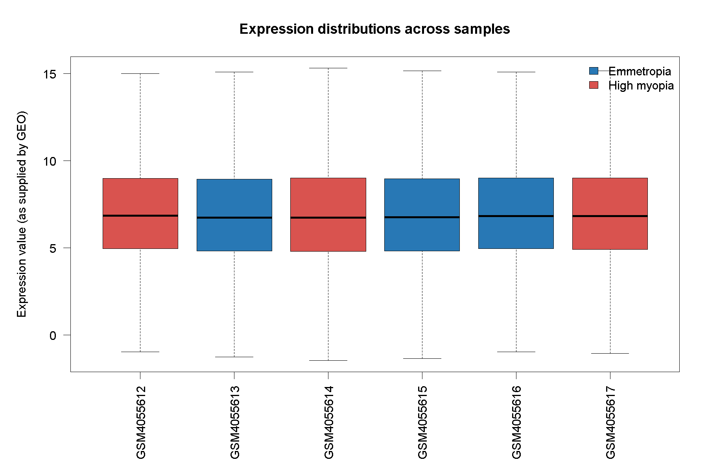
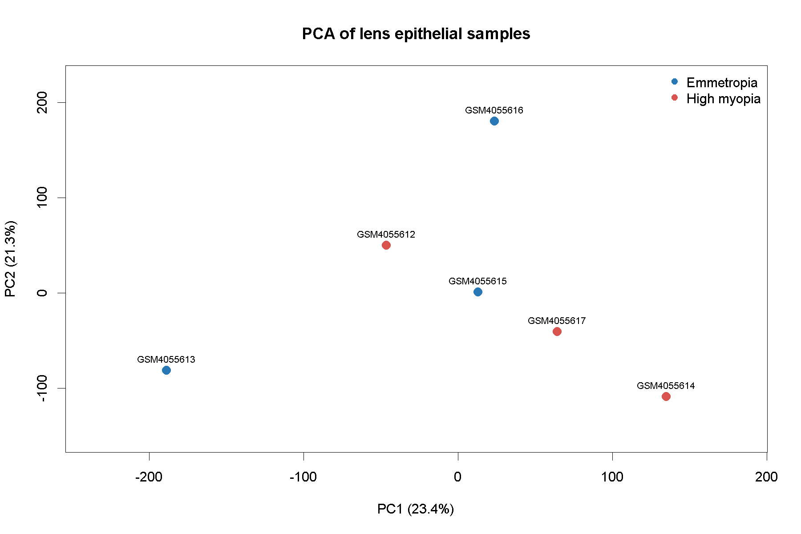
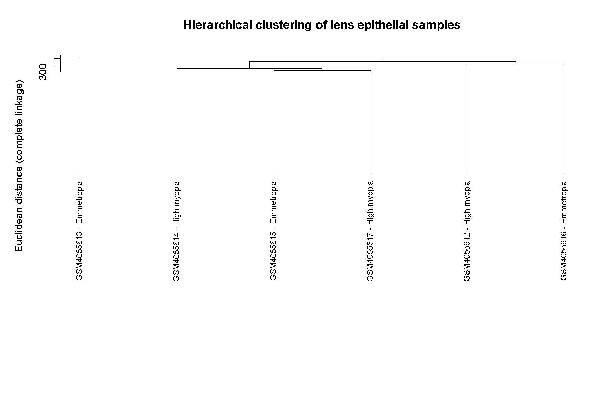
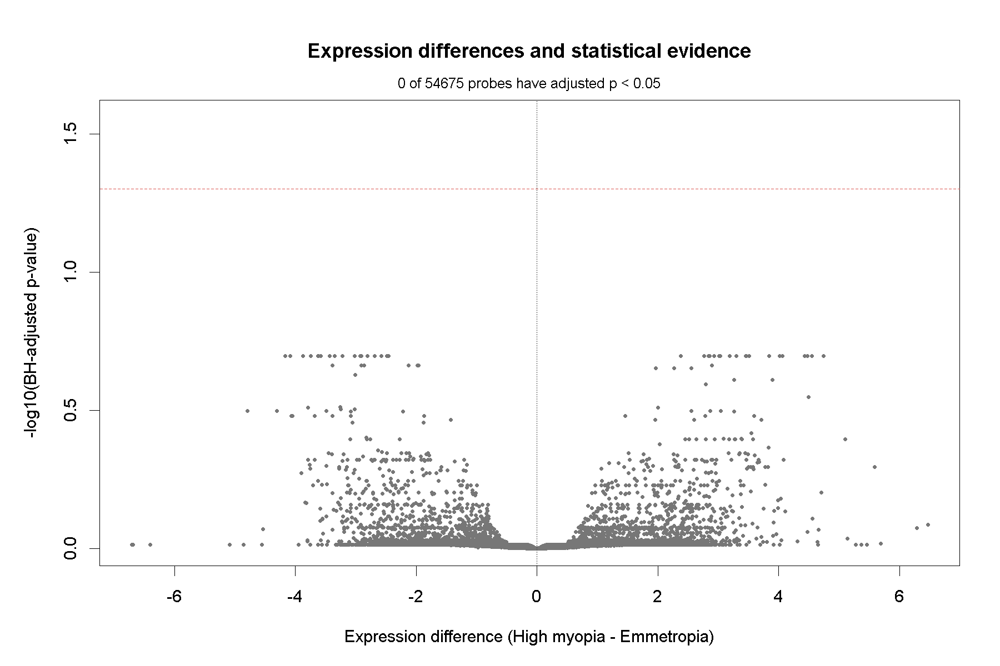
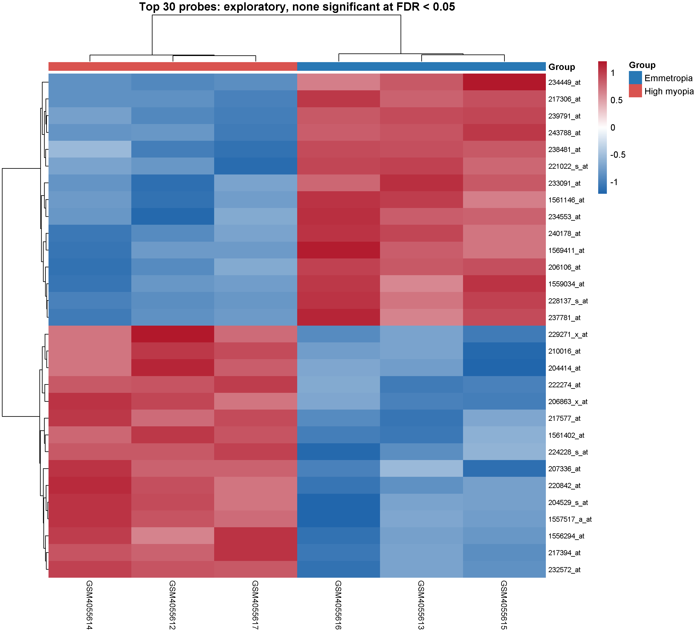

```{r setup, include=FALSE}
# Find the project root whether knitting starts in code/ or the root
if (file.exists("myopic and emmetropic human eye.R")) {
  project_root <- normalizePath("..", winslash = "/")
} else if (file.exists("code/myopic and emmetropic human eye.R")) {
  project_root <- normalizePath(".", winslash = "/")
} else {
  stop(
    "Cannot find the import script. Check its filename and ",
    "save analysis_report.Rmd inside the project's code folder."
  )
}

knitr::opts_knit$set(root.dir = project_root)
knitr::opts_chunk$set(echo = TRUE, message = FALSE, warning = TRUE,
                      error = FALSE, cache = FALSE, fig.width = 10,
                      fig.height = 7, out.width = "100%")
required_packages <- c("GEOquery", "Biobase", "limma", "pheatmap")
missing_packages <- required_packages[
  !vapply(required_packages, requireNamespace, logical(1), quietly = TRUE)
]
if (length(missing_packages)) {
  stop("Install these packages before knitting: ",
       paste(missing_packages, collapse = ", "))
}
# Scripts share this notebook's evaluation environment.
run_script <- function(path) {
  sys.source(path, envir = knitr::knit_global())
}
```

# Overview

I compare expression in three high-myopia and three emmetropic human lens
epithelial samples from NCBI GEO GSE136701. The aim is to explore sample
relationships and test for differences between groups. This notebook reruns the
existing R scripts; it does not rely on objects in the RStudio Global Environment.
An internet connection is required for the GEO downloads.

This is an exploratory analysis of older adult surgical samples, not a clinical
prediction tool. Probe-level results are not automatically gene-level findings.

# Import the dataset

The import script downloads the GEO Series Matrix to a temporary file, then
extracts expression values and metadata. Platform annotation is not downloaded.

```{r import}
run_script("code/myopic and emmetropic human eye.R")
knitr::kable(data.frame(
  Measurement = c("Probes", "Samples", "Missing values", "Infinite values"),
  Value = c(nrow(expr), ncol(expr), sum(is.na(expr)), sum(is.infinite(expr)))
))
annotation(eset)
summary(as.vector(expr))
```

# Sample information and quality checks

Groups are assigned from recorded diagnoses, not assumed sample order. The
quality-check script verifies alignment, checks finite values, and exports the
sample table. The participants are aged 53–68 years. Emmetropia is the recorded
control diagnosis, not a claim that all controls are otherwise healthy.

```{r quality-checks}
run_script("code/02_quality_checks.R")
knitr::kable(sample_table, caption = "Verified sample identities, groups and ages")
```

# Expression-scale verification

GEO describes MAS 5.0 normalisation in GeneSpring 12.6.1 but does not explicitly
identify the transformation scale in the inspected descriptions. The next script
compares one submitted sample record against the matrix.

```{r scale-check}
run_script("code/check_expression_scale.R")
```

For GSM4055612, all 54,675 submitted values matched the matrix exactly, with 63
non-positive values. This verifies import fidelity, not the original
transformation. I retain the supplied values unchanged and report estimated
effects as expression differences, not confirmed log2 fold changes. The
appropriateness of this scale for linear modelling remains a limitation.

# Exploratory analysis

```{r run-exploration}
# Requires the corrected version of this script: sample_clusters must be
# created before any axis command refers to its height.
run_script("code/03_exploratory_analysis.R")
```

## Expression distributions

```{r boxplot, echo=FALSE}

```

The six samples have broadly similar medians and spreads. This does not establish
that every sample is free from technical artefacts. Hiding outlier symbols in the
boxplot does not remove observations from the analysis.

## Principal component analysis

```{r pca, echo=FALSE}

```

PCA uses all probes, with centring but no scaling to unit variance. PC1 explains
`r sprintf("%.2f%%", variance_percent[1])` and PC2 explains
`r sprintf("%.2f%%", variance_percent[2])` of variation. Together they account for
`r sprintf("%.2f%%", sum(variance_percent[1:2]))`. The first two components do not
show clear separation by diagnosis.

## Sample clustering

```{r clustering, echo=FALSE}

```

Euclidean distance and complete linkage produce mixed diagnostic groups. No
sample is excluded solely because of its position in this exploratory tree.

# Differential expression analysis

The limma model compares High myopia minus Emmetropia, with diagnosis as its only
predictor. Positive effects indicate higher expression in high myopia. Empirical
Bayes moderation is followed by Benjamini–Hochberg adjustment across the probes.
The selection rule is adjusted p-value below 0.05. Age and gender are not adjusted.

```{r differential-analysis}
run_script("code/04_differential_expression.R")
n_significant <- sum(results$adj.P.Val < 0.05, na.rm = TRUE)
knitr::kable(data.frame(
  Measure = c("Probes tested", "Adjusted p < 0.05", "Minimum adjusted p"),
  Value = c(nrow(results), n_significant, min(results$adj.P.Val, na.rm = TRUE))
), caption = "Differential analysis summary")
knitr::kable(head(results, 10), digits = 6,
             caption = "Top-ranked probes; ranking does not imply significance")
```

The model identifies **`r n_significant` probes** at adjusted p < 0.05. The
smallest adjusted p-value is `r signif(min(results$adj.P.Val, na.rm = TRUE), 4)`.
The observed zero-significant-probe result does not prove biological equivalence.
The significant-probes CSV is expected to contain only headers when no probes
pass the threshold.

# Results visualisation

```{r run-result-plots}
run_script("code/05_results_visualisation.R")
```

## Expression differences and statistical evidence

```{r effect-plot, echo=FALSE}

```

The horizontal axis is the estimated expression difference. The vertical axis is
negative log10 adjusted p-value. All points in the observed result fall below the
0.05 threshold line. Horizontal bands can occur when probes share adjusted
p-values.

## Exploratory top-30 heatmap

```{r heatmap, echo=FALSE}

```

These probes were selected by the smallest unadjusted p-values in the same group
comparison. Their apparent separation of diagnoses is therefore not independent
validation. None passed the adjusted threshold in this analysis. Colours show
row z-scores: red is above a probe's own average and blue is below it. They do not
compare absolute expression across different probes.

# Discussion and conclusion

This workflow found no statistically significant probe-level differences at the
specified adjusted threshold. The all-probe exploratory plots showed substantial
within-group variation, while a selected-probe heatmap highlighted descriptive
patterns. These findings have different purposes and are not contradictory.

Limitations include three samples per group, restriction to older adult lens
surgical tissue, possible confounding, and incomplete documentation of the
supplied expression scale. Raw-array quality checks, gene annotation, pathway
analysis, and independent validation were not performed. Changing the name of
the effect column does not resolve modelling assumptions. Larger independent
samples and clarified preprocessing would be needed for stronger conclusions.

I reused publicly available study data and did not recruit participants or
collect new tissue. The dataset-specific licence was not established during
this project; public availability is not treated as proof of a particular licence.

# Verify outputs and record the environment

```{r verify-outputs}
expected_files <- c(
  "results/Sample_Information.csv",
  "results/All_Results.csv",
  "results/Significant_Probes.csv",
  "figures/01_Expression_Boxplot.png",
  "figures/02_PCA_Plot.png",
  "figures/03_Sample_Clustering.png",
  "figures/04_Effect_Significance_Plot.png",
  "figures/05_Top30_Exploratory_Heatmap.png"
)
knitr::kable(data.frame(File = expected_files,
                        Exists = file.exists(expected_files)))
stopifnot(all(file.exists(expected_files)))
writeLines(capture.output(sessionInfo()), "results/sessionInfo.txt")
sessionInfo()
```

# Sources and software citations

Dataset: [NCBI GEO GSE136701](https://www.ncbi.nlm.nih.gov/geo/query/acc.cgi?acc=GSE136701).
Sample record: [GSM4055612](https://www.ncbi.nlm.nih.gov/geo/query/acc.cgi?acc=GSM4055612).
The study publication identifier in GEO metadata is PMID 33833231.

The following citations are produced from the installed packages.

```{r citations, results='asis', echo=FALSE}
for (pkg in c("GEOquery", "Biobase", "limma", "pheatmap", "rmarkdown", "knitr")) {
  cat("\n\n## ", pkg, "\n\n", sep = "")
  cat(paste(as.character(citation(pkg)), collapse = "\n\n"))
  cat("\n\n")
}
```
